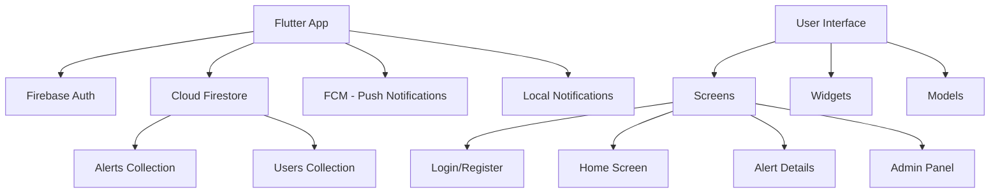

# 🎓 College Alerts App

> **A comprehensive Flutter-based mobile application for managing and distributing college alerts and notifications**

[](https://flutter.dev)
[](https://firebase.google.com)
[](https://dart.dev)
[](#license)

---

## 📋 Table of Contents

- [🎯 Overview](#-overview)
- [✨ Features](#-features)
- [📱 Screenshots](#-screenshots)
- [🚀 Installation](#-installation)
- [💡 Usage](#-usage)
- [🏗️ Architecture](#️-architecture)
- [🛠️ Tech Stack](#️-tech-stack)
- [🔧 Development Setup](#-development-setup)
- [📖 Documentation](#-documentation)

---

## 🎯 Overview

The **College Alerts App** is a modern, cross-platform mobile application built with Flutter that enables educational institutions to efficiently manage and distribute important alerts, announcements, and notifications to students and staff.

### 🎯 Purpose

This application addresses the critical need for timely communication in educational environments by providing:

- **Real-time notifications** for urgent announcements
- **Centralized alert management** for administrators
- **Cross-platform accessibility** for all users
- **Secure authentication** to ensure information reaches the right audience

### 👥 Target Audience

- **Students**: Receive important college updates and alerts
- **Faculty & Staff**: Stay informed about institutional announcements
- **Administrators**: Manage and distribute alerts efficiently
- **Educational Institutions**: Streamline communication processes

### 🎯 Key Benefits

- ⚡ **Instant Delivery**: Push notifications ensure immediate alert delivery
- 🔒 **Secure Access**: Authentication-based system protects sensitive information
- 📱 **Multi-Platform**: Works seamlessly across iOS, Android, and Web
- 🎨 **User-Friendly**: Intuitive interface designed for all user levels
- ☁️ **Cloud-Based**: Firebase backend ensures reliability and scalability

---

## ✨ Features

### 🔐 **Authentication System**

- User registration and login
- Secure admin authentication
- Profile management
- Session persistence

### 📢 **Alert Management**

- View all current alerts and announcements
- Detailed alert information with timestamps
- Author attribution for transparency
- Real-time alert updates

### 🔔 **Push Notifications**

- Instant notification delivery
- Firebase Cloud Messaging integration
- Local notification support
- Background notification handling

### 👨‍💼 **Admin Panel**

- Secure admin login (ID: 1, Password: 123456)
- Create and publish new alerts
- Manage alert distribution
- Administrative oversight tools

### 📱 **User Interface**

- Modern Material Design
- Responsive layout for all screen sizes
- Intuitive navigation with drawer menu
- Custom color scheme and typography

### 🌐 **Cross-Platform Support**

- **Mobile**: iOS and Android
- **Desktop**: Windows, macOS, and Linux
- **Web**: Progressive Web App (PWA) support

---

## 📱 Screenshots


---

## 🚀 Installation

### 📋 Prerequisites

Before installing the College Alerts App, ensure you have:

- **Flutter SDK** (Version 3.5.3 or higher)
- **Dart SDK** (Included with Flutter)
- **Firebase Account** and Project Setup
- **IDE**: Android Studio, VS Code, or IntelliJ IDEA
- **Platform-specific requirements**:
  - **Android**: Android Studio, Android SDK
  - **iOS**: Xcode (macOS only)
  - **Web**: Chrome browser
  - **Desktop**: Platform-specific build tools

### 🛠️ Step-by-Step Installation

#### 1️⃣ **Clone the Repository**

```bash
git clone https://github.com/yourusername/collage-alerts-app.git
cd collage-alerts-app
```

#### 2️⃣ **Install Dependencies**

```bash
flutter pub get
```

#### 3️⃣ **Firebase Setup**

1. Create a new Firebase project at [Firebase Console](https://console.firebase.google.com)
2. Enable the following services:
   - Authentication
   - Cloud Firestore
   - Cloud Messaging
3. Download and add configuration files:
   - **Android**: `google-services.json` → `android/app/`
   - **iOS**: `GoogleService-Info.plist` → `ios/Runner/`
   - **Web**: Update Firebase config in `lib/firebase_options.dart`

#### 4️⃣ **Configure Firebase CLI** (Optional but recommended)

```bash
npm install -g firebase-tools
firebase login
firebase init
```

#### 5️⃣ **Run the Application**

**For Mobile (Android/iOS):**

```bash
flutter run
```

**For Web:**

```bash
flutter run -d chrome
```

**For Desktop:**

```bash
# Windows
flutter run -d windows

# macOS
flutter run -d macos

# Linux
flutter run -d linux
```

### 🐳 Docker Setup (Optional)

```dockerfile
# Dockerfile example for web deployment
FROM nginx:alpine
COPY build/web /usr/share/nginx/html
EXPOSE 80
CMD ["nginx", "-g", "daemon off;"]
```

---

## 💡 Usage

### 👤 **For Students/Users**

1. **Registration/Login**

   ```dart
   // Navigate to registration
   Navigator.pushNamed(context, '/register');
   ```

   - Create an account with email and password
   - Login with existing credentials

2. **Viewing Alerts**

   - Home screen displays all recent alerts
   - Tap on any alert for detailed information
   - Use notification icon to view alert history

3. **Profile Management**
   - Access profile through the menu or top-right icon
   - Update personal information
   - Manage notification preferences

### 👨‍💼 **For Administrators**

1. **Admin Access**

   ```dart
   // Admin credentials (default)
   Admin ID: 1
   Password: 123456
   ```

2. **Creating Alerts**

   - Login through admin panel
   - Navigate to "Add New Alert"
   - Fill in alert details:
     - Title
     - Description
     - Target audience

3. **Managing Notifications**
   - Alerts are automatically distributed via push notifications
   - Monitor alert delivery status

### 🔔 **Notification System**

The app uses Firebase Cloud Messaging for real-time notifications:

```dart
// Example notification payload
{
  "title": "Emergency Alert",
  "body": "Campus closure due to weather conditions",
  "data": {
    "alertId": "alert_123",
    "priority": "high"
  }
}
```

---

## 🏗️ Architecture

### 📐 **App Architecture**



### 🗂️ **Project Structure**

```
lib/
├── api/                    # Backend API services
│   ├── firebase_api.dart   # Firebase configuration
│   ├── firestore_serves.dart # Firestore operations
│   └── push_notifi.dart    # Push notification handling
├── models/                 # Data models
│   └── alerts.dart         # Alert model class
├── screens/               # UI screens
│   ├── home_screen.dart   # Main dashboard
│   ├── login_screen.dart  # User authentication
│   ├── alerts_screen.dart # Alert details
│   └── admin_login_page.dart # Admin panel
├── widgets/               # Reusable UI components
│   ├── custom_button.dart
│   ├── custom_card.dart
│   └── email_text_field.dart
├── const.dart            # App constants & styling
├── main.dart            # App entry point
└── firebase_options.dart # Firebase configuration
```

---

## 🛠️ Tech Stack

### 📱 **Frontend**

- **Flutter** `^3.5.3` - Cross-platform UI framework
- **Dart** - Programming language
- **Material Design** - UI design system

### ☁️ **Backend & Services**

- **Firebase Core** `^3.6.0` - Firebase SDK
- **Cloud Firestore** `^5.4.4` - NoSQL database
- **Firebase Messaging** `^15.1.3` - Push notifications
- **Firebase Auth** - User authentication

### 📦 **Key Dependencies**

```yaml
dependencies:
  flutter:
    sdk: flutter
  cloud_firestore: ^5.4.4
  firebase_core: ^3.6.0
  firebase_messaging: ^15.1.3
  flutter_local_notifications: ^17.2.3
  googleapis_auth: ^1.6.0
  http: ^1.2.2
  intl: ^0.19.0
  cupertino_icons: ^1.0.8

dev_dependencies:
  flutter_test:
    sdk: flutter
  flutter_lints: ^4.0.0
```

### 🗃️ **Database Schema**

**Alerts Collection:**

```json
{
  "alertId": "unique_id",
  "title": "Alert Title",
  "description": "Detailed description",
  "dateTime": "2024-01-01T10:00:00Z",
  "createdBy": "admin_username",
  "priority": "high|medium|low",
  "targetAudience": "all|students|faculty"
}
```

---

## 🔧 Development Setup

### 🏃‍♂️ **Quick Start for Developers**

1. **Fork and Clone**

   ```bash
   git clone https://github.com/your-username/collage-alerts-app.git
   cd collage-alerts-app
   ```

2. **Setup Development Environment**

   ```bash
   # Install dependencies
   flutter pub get

   # Run code generation (if needed)
   flutter packages pub run build_runner build

   # Check for issues
   flutter analyze

   # Run tests
   flutter test
   ```

3. **Development Commands**

   ```bash
   # Hot reload during development
   flutter run --hot

   # Build for different platforms
   flutter build apk          # Android
   flutter build ios          # iOS
   flutter build web          # Web
   flutter build windows      # Windows
   ```

### 🧪 **Testing**

```bash
# Run all tests
flutter test

# Run with coverage
flutter test --coverage

# Widget tests
flutter test test/widget_test.dart

# Integration tests
flutter drive --target=test_driver/app.dart
```

### 🔧 **Development Tools**

- **IDE Extensions**:

  - Flutter & Dart plugins
  - Firebase extensions
  - GitLens for version control

- **Debugging**:

  - Flutter Inspector
  - Firebase Debug View
  - Network monitoring tools

- **Code Quality**:
  - Dart analyzer
  - Flutter linting rules
  - Pre-commit hooks (recommended)

---

## 📖 Documentation

### 📚 **Additional Resources**

- **API Documentation**: [Coming Soon]
- **User Manual**: [Coming Soon]
- **Admin Guide**: [Coming Soon]
- **Deployment Guide**: [Coming Soon]

### 🔗 **External Documentation**

- [Flutter Documentation](https://docs.flutter.dev/)
- [Firebase Documentation](https://firebase.google.com/docs)
- [Dart Language Guide](https://dart.dev/guides)
- [Material Design Guidelines](https://material.io/design)

### 📋 **Configuration Files**

- `pubspec.yaml` - Dependencies and app metadata
- `firebase.json` - Firebase hosting configuration
- `analysis_options.yaml` - Dart analyzer configuration

---

### 🔍 **Troubleshooting**

**Common Issues:**

1. **Build Errors**

   ```bash
   flutter clean
   flutter pub get
   flutter run
   ```

2. **Firebase Connection Issues**

   - Verify `google-services.json` placement
   - Check Firebase project configuration
   - Ensure proper API keys

3. **Notification Not Working**
   - Check device notification permissions
   - Verify FCM token generation
   - Test with Firebase Console

### 📋 **Reporting Issues**

When reporting issues, please provide:

1. Error messages and stack traces
2. Steps to reproduce
3. Device/platform information
4. App version

---

### 🛠️ **Tools & Technologies**

- **[Flutter](https://flutter.dev)** - For the amazing cross-platform framework
- **[Firebase](https://firebase.google.com)** - For reliable backend services
- **[Material Design](https://material.io)** - For design inspiration and guidelines
- **[GitHub](https://github.com)** - For version control and collaboration

### 📚 **Learning Resources**

- Flutter community tutorials and documentation
- Firebase official guides and best practices
- Material Design principles and components
- Dart language features and best practices

### 🎨 **Design Inspiration**

- Modern mobile app design trends
- Educational app UX patterns
- Accessibility guidelines and standards

---

<div align="center">

### 🌟 **Star this repository if you find it helpful!**

**Made with ❤️ for Educational Institutions**

[⬆️ Back to Top](#-college-alerts-app)

</div>
